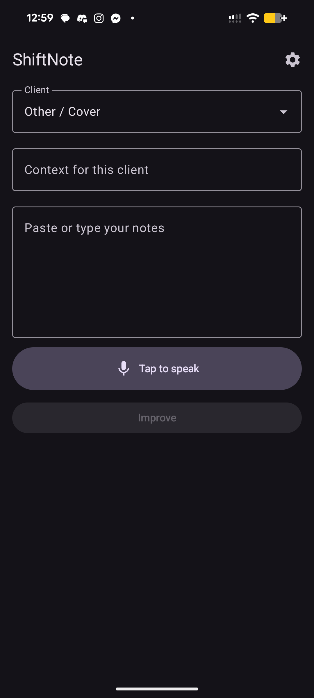
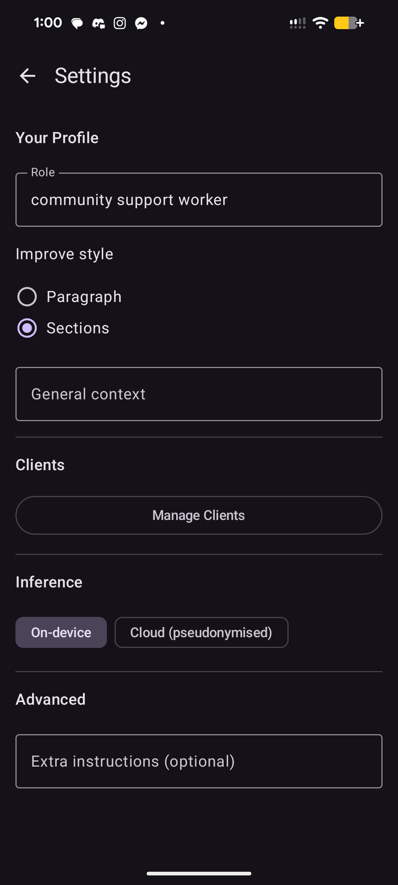

# ShiftNote

[](https://github.com/rosshunterdev/shiftnote/actions/workflows/test.yml)

An Android app that helps support workers turn rough shift notes into clear, professional case notes, with privacy as the first design constraint.

## What it is

Community support workers write a case note after every shift about the person they support. The notes are usually written on a phone, at the end of a long shift. Getting help from AI normally means pasting notes about vulnerable people into a public chatbot and hoping nothing identifying slips through.

ShiftNote rewrites the note for you. By default the AI model runs entirely on the phone, so the note never leaves the device. There is an opt-in cloud mode for better output. In cloud mode the app replaces the client's details with placeholders on the phone first, shows you exactly what will be sent, and only sends it once you confirm.

## Screenshots

| Main screen | Settings |
|---|---|
|  |  |

## Status

**In development.** A personal project, tested on a Pixel 8a (Android 16) with made-up notes only. Not production-ready and not used with real client data.

| | |
|---|---|
| **Works** | On-device rewriting, cloud mode with pseudonymisation and preview, client profiles, both Improve styles, on-device voice input (also works in airplane mode) |
| **Partial** | Gemma 3 1B's rewrites are not good enough yet. Voice input loses some words when the speaker talks through a short pause. The golden test set exists, but scoring is still done by hand. |
| **Next** | A script to score model output against the golden set, a "Suggest" mode that gives tips without rewriting the note, and moving off deprecated Google libraries (see Known gaps) |

## Features

- **On-device rewriting:** Gemma 3 1B running locally through MediaPipe LLM Inference. No network, no account.
- **Opt-in cloud mode:** the Gemini API, using your own API key. Off by default.
- **Pseudonymisation before any cloud call:** client details are swapped for placeholders such as `[CLIENT]` and `[PHONE_1]` on the phone. You see a preview of the exact text before it is sent, and the real details are put back into the reply on the phone.
- **On-device voice input:** tap to speak, using Android's on-device `SpeechRecognizer`. The words appear live in the note box. Needs Android 12 or later.
- **Client profiles:** each client's goals and extra context, stored locally with Room and added to the prompt as background.
- **Two Improve styles:** Paragraph (plain prose) or Sections (Activities, Wellbeing, Follow-up), plus optional extra instructions.
- **Flags instead of guessing:** anything unclear is kept and marked `[REVIEW: reason]` rather than invented.

## Privacy design

**Implemented:**
- Client details are pseudonymised on the phone before any cloud call, and you confirm a preview first.
- Notes are held in memory only. There is no note history and no log of note content.
- The Gemini API key is stored encrypted (`EncryptedSharedPreferences`, AES-256).
- Backups and device-to-device transfer are disabled (`allowBackup="false"` plus data extraction rules).
- Speech recognition runs on the device. The audio is never stored by the app.

**Known gaps:**
- The Room database holding client profiles is not encrypted beyond Android's standard device encryption.
- On the free Gemini API tier, Google may use prompts to improve its products. Cloud mode is not suitable for real client notes as it stands.
- The Redactor is pattern-based and misses some things:
  - A client name that is also a common word (for example "Will") also replaces that word everywhere in the note.
  - Other people's names (family, staff, other clients) are not detected.
  - With no client selected, no names are replaced at all. Phone numbers, addresses and NHI numbers are still caught.
- Two Google libraries in use are deprecated: the `generativeai` client SDK (Google now points to Firebase AI Logic) and `EncryptedSharedPreferences`. MediaPipe LLM Inference is also in maintenance-only mode, with LiteRT-LM as its successor. All three still work, and replacing them is on the Next list.

Pseudonymised text can still contain details that identify someone, which is why the preview step exists.

## Architecture

Both AI engines sit behind one small interface, so the rest of the app doesn't know which one it is talking to:

```kotlin
interface NoteRestructurer {
    suspend fun restructure(prompt: String): Result<String>
    suspend fun isAvailable(): Boolean
}
```

```
MainScreen ──> MainViewModel ──> PromptAssembler (note + role + style + client profile)
                     │
                     ├── on-device ──> GemmaRestructurer ──> MediaPipe + Gemma 3 1B
                     │
                     └── cloud ──> Redactor ──> preview dialog ──> GeminiCloudRestructurer
                                      ^                                     │
                                      └──────── restore placeholders <──────┘
```

The engine is chosen in one factory in `ShiftNoteApp.kt` based on the user's setting. Voice input follows the same pattern: a `SpeechTranscriber` interface with an Android implementation and a fake for tests.

Code is in `app/src/main/java/com/shiftnote/`:

- `inference/`: `NoteRestructurer`, both engines, `PromptAssembler`, `Redactor`
- `speech/`: `SpeechTranscriber`, `AndroidSpeechTranscriber`, `VoiceInput`
- `ui/`: Jetpack Compose screens (main, client profiles, settings)
- `data/`: Room database and preferences

Design specs for each feature, including the options considered and why they were rejected, are in [`docs/design/`](docs/design/).

## Tech stack

| | Version |
|---|---|
| Kotlin | 2.3.21 |
| Android Gradle Plugin / Gradle | 8.6.0 / 9.0.0 |
| Jetpack Compose (BOM) | 2026.03.01 |
| Navigation Compose | 2.8.2 |
| Room (with KSP) | 2.7.0 |
| MediaPipe tasks-genai | 0.10.29 |
| Google AI client SDK (`generativeai`) | 0.9.0 |
| AndroidX security-crypto | 1.1.0-alpha06 |
| minSdk / targetSdk | 26 / 35 (voice input needs 31+) |
| JDK | 17 or later |

## Running it

**You need:** Android Studio or the Android SDK, JDK 17 or later, and an Android phone (on-device AI needs a recent phone with plenty of RAM; tested on a Pixel 8a).

1. Build and install the debug app with the phone connected:
   ```
   ./gradlew installDebug
   ```
2. Open the app once, so it creates its storage folder.
3. **Get the Gemma model.** It is not included in this repo because of its size and the [Gemma Terms of Use](https://ai.google.dev/gemma/terms). Download a Gemma 3 1B `.task` file from the official [LiteRT community page on Hugging Face](https://huggingface.co/litert-community/Gemma3-1B-IT) (you need to accept the licence). See Google's [MediaPipe LLM Inference guide](https://developers.google.com/edge/mediapipe/solutions/genai/llm_inference/android) for background.
4. Copy it into the app's private storage as `gemma3-1b.task`:
   ```
   adb push <downloaded-file>.task /data/local/tmp/gemma3-1b.task
   adb shell run-as com.shiftnote cp /data/local/tmp/gemma3-1b.task /data/data/com.shiftnote/files/gemma3-1b.task
   ```
5. **Optional, for cloud mode:** get a free API key from [Google AI Studio](https://aistudio.google.com/), then in the app go to Settings, choose Cloud mode and paste the key.

## Testing

```
./gradlew testDebugUnitTest
```

69 JVM unit tests cover prompt assembly, the Redactor, the main screen ViewModel and voice input logic. They also run on every push through GitHub Actions. The AI engines, permissions and screens are checked by hand on a phone.

AI output quality is checked against a [golden set](docs/eval/golden-set.md) of 10 made-up notes. Each note has an ideal rewrite and targets a specific failure: invented facts, a client name slipping through, ambiguous pronouns, long notes being cut off, and more.

## How I built this

I built ShiftNote with Claude Code as a pair programmer, using the same loop for each feature:

1. Write a design spec: the problem, the options, the decision and the risks ([`docs/design/`](docs/design/)).
2. Turn it into a step-by-step plan, with tests written first.
3. Build it in small commits, reviewing each change.
4. Check it on a real phone with made-up notes from the golden set.

Risky platform questions (for example "does on-device speech work in airplane mode?") were checked on the phone before building the feature around them.

## Roadmap

A cloud backend is planned but **not built**. It would let other support workers try ShiftNote with made-up notes, hosted in an Australian or New Zealand region, using AI providers that don't train on or keep the data.

## Data

There is no real client data in this repository. Every name and note is made up.

## Licence

Copyright (c) 2026 Ross Hunter. All rights reserved. The code is shared so people can read it. Please ask before reusing it.
